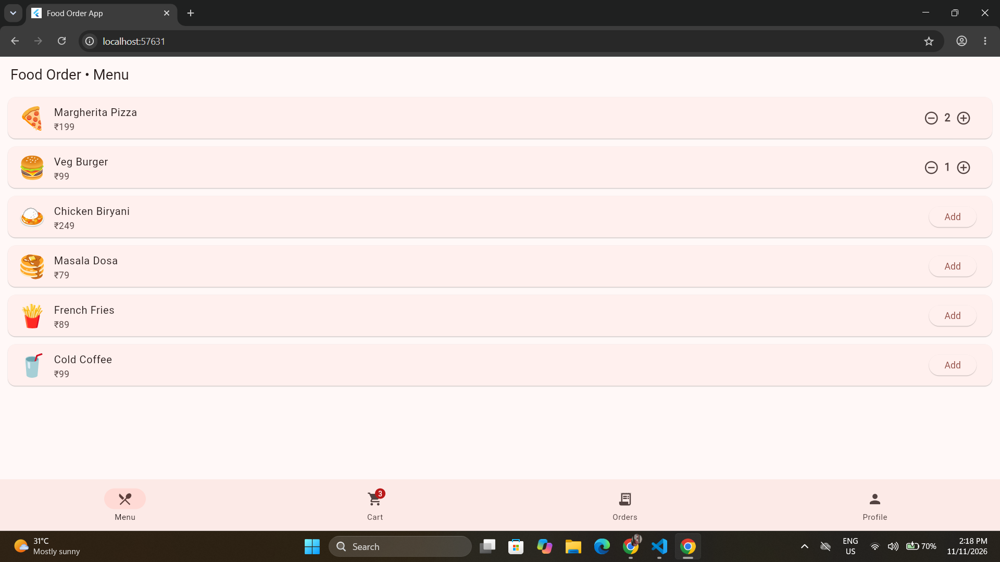
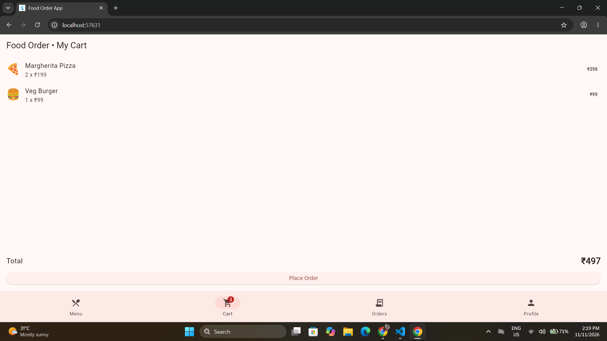
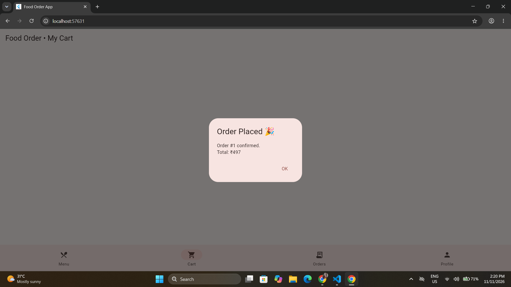
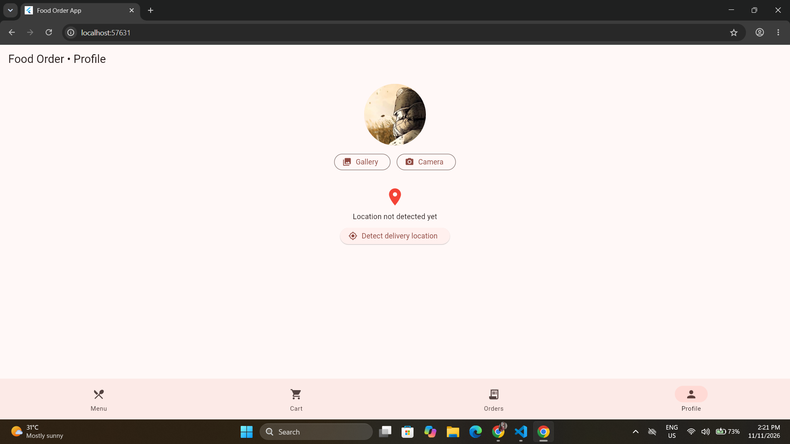

# Food Order App (Flutter)
A feature-rich food ordering prototype.

## Features
- Advanced state management with Provider (cart, orders)
- Menu, cart with quantity controls, total price
- Order confirmation notification (in-app dialog)
- Gallery / camera photo selection (image_picker)
- Device location with permission handling (geolocator)
- Error handling for denied permissions and failures

## Performance and Build
- Profiled with Flutter DevTools
- Release build: flutter build web --release
- Android permissions: location and camera (AndroidManifest.xml)

## Screenshots

